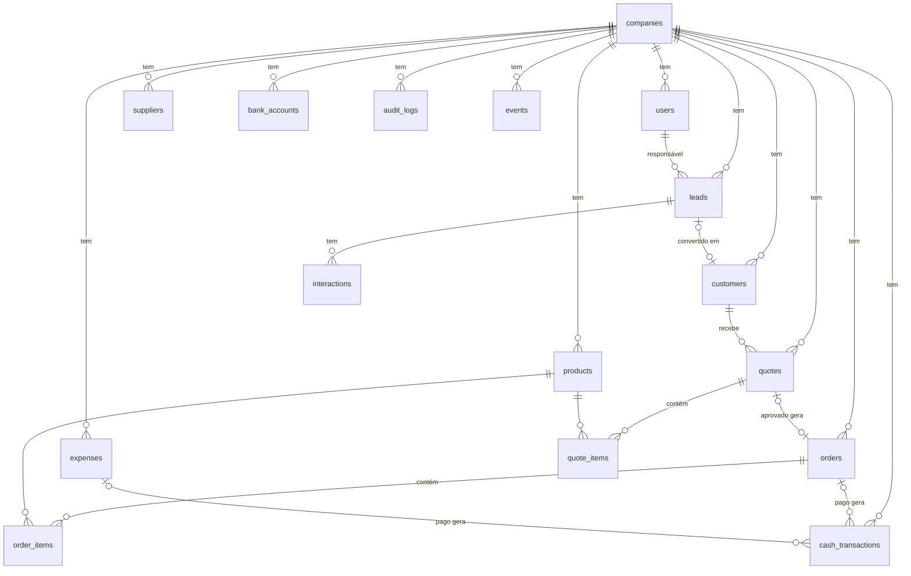

# Planejamento da Versão 2 — Aranduê SaaS

> **Escopo:** evolução do protótipo Aranduê (monousuário) para um SaaS multiempresa com ERP, CRM, análise gerencial e assistente de IA.
> **Prazo:** 4 semanas (02/11/2026 a 29/11/2026), entrega na semana de 30/11.
> **Base:** *Guia SaaS de Gestão para MEI* (requisitos RF/RNF e histórias HU) + avaliação técnica da versão 1.

---

## 1. Proposta

> **O Aranduê ajuda microempreendedores individuais a organizar vendas, clientes e caixa em um só lugar, com um assistente que responde dúvidas e registra informações pelo Telegram.**

### Premissas

- Desenvolvimento por **uma pessoa**. Com equipe, as trilhas *backend* e *frontend* de cada semana podem correr em paralelo.
- O guia sugere 12 semanas para a Fase 1. Este plano cabe em 4 porque **reaproveita** a v1 (layout, componentes, estoque, caixa) e **corta** o que não é essencial para a demonstração (seção 3).
- Feriados no período: 15/11 (domingo) e 20/11 (sexta-feira, Consciência Negra).

---

## 2. Decisões tomadas

| Tema | Decisão | Motivo |
|---|---|---|
| Banco | **PostgreSQL 17**: Docker no desenvolvimento, **Supabase em São Paulo** (`sa-east-1`) no deploy | Recomendação do guia; o schema será reescrito de qualquer forma para multiempresa |
| Linguagem | **TypeScript estrito** no backend, no frontend e no pacote compartilhado | Erros de tipo e de contrato aparecem antes de rodar; é o maior ganho de manutenção a longo prazo |
| Backend | **Fastify 5** com camada de serviços | Mais rápido que o Express, com validação e serialização por schema embutidas; RNF08: web, bot e chat usam as mesmas regras |
| Acesso a dados | **Drizzle ORM** + `drizzle-kit` (migrações) sobre o driver `postgres` | Tipado, leve e próximo do SQL, sem *runtime* pesado; bom para funções *serverless* |
| Validação | **Zod**, com os mesmos schemas no front e no back (`packages/shared`) | Uma única fonte de verdade (na v1 a lista de campos obrigatórios estava duplicada) |
| Autenticação | Própria: **Argon2id + sessão no Postgres** em cookie `httpOnly; Secure; SameSite=Lax` | Argon2id é o algoritmo recomendado hoje pela OWASP (substitui o bcrypt do RNF02 com vantagem); a sessão no banco permite logout e revogação reais. Não usaremos Supabase Auth |
| Frontend | **React 19 + Vite + TanStack Query + React Router** (rotas com *lazy loading*) | Reaproveita a v1; cache e deduplicação de requisições; cada tela baixa só o próprio código |
| Hospedagem | **Vercel em São Paulo (`gru1`)** para frontend **e** API (Fastify como Vercel Function, *Fluid compute*) | API e banco na mesma região; front e API no mesmo domínio (sem CORS, cookie *first-party*). O Render saiu do plano por não ter região no Brasil |
| Financeiro e estoque | **Mantidos no MVP**, só com correções | Já funcionam; o KPI do limite do MEI depende de faturamento real |
| IA | **Chat de ajuda (3.1)** e **bot do Telegram (3.3)**, versão simples | Sugestão do próprio guia para a nota |
| Nomes no código | Tabelas e código em **inglês** (padrão da v1) | Menos retrabalho; a seção 5 mapeia para os nomes em português do guia |

### 2.1 Stack por etapa

O que mais pesa no desempenho de um SaaS deste porte não é o *framework*: é a **latência de rede** (região), o **número de consultas por tela** e o **tamanho do JavaScript** baixado. A stack foi escolhida para atacar esses três pontos, nessa ordem.

| Etapa | Tecnologia | Desempenho | Segurança | Manutenção |
|---|---|---|---|---|
| Base | Node 24 LTS, TypeScript estrito, npm *workspaces* (`backend`, `frontend`, `packages/shared`) | — | Tipos nos limites da API | Contratos compartilhados; LTS com suporte longo |
| Qualidade | **Biome** (lint + formatação), **GitHub Actions** (typecheck, lint, testes, `npm audit`), **Dependabot** | Ferramenta única e rápida | Alerta de dependência vulnerável | Atualizações pequenas e frequentes |
| API | **Fastify 5** + `fastify-type-provider-zod`, `@fastify/helmet`, `@fastify/rate-limit`, `@fastify/cookie`, logs **pino** (nativo) | Serialização por schema; log assíncrono | Cabeçalhos seguros, CSP, limite de tentativas no login | Plugins oficiais mantidos pelo time do Fastify |
| Dados | **Drizzle** + driver `postgres` (`prepare: false` no *pooler* em modo transação); índices `(company_id, ...)`; paginação por cursor; KPIs agregados em SQL | Sem N+1; conexões reaproveitadas | Consultas parametrizadas; usuário de banco com privilégio mínimo (não o `postgres`) | Migrações versionadas e tipadas |
| Tarefas agendadas | **`pg_cron`** no Supabase (ex.: marcar orçamento parado há 7 dias) | Roda dentro do banco | — | Sem servidor extra |
| Frontend | React 19, Vite, **TanStack Query**, React Router (*lazy routes*), **React Hook Form + Zod** | Cache de dados, menos requisições, menos JS por tela | Validação igual à do servidor | Formulários sem estado manual |
| Interface | CSS atual da v1 (já responsivo) + **Radix Primitives** só em diálogo, menu e abas | CSS pequeno, sem *framework* de UI | — | Componentes acessíveis prontos |
| Gráficos | **Recharts**, carregado só na tela de análise | Não pesa nas outras telas | — | Biblioteca React madura |
| Hospedagem | **Vercel `gru1`** + **Supabase `sa-east-1`** | Ida e volta dentro de São Paulo | HTTPS automático; segredos em variáveis de ambiente | Deploy de pré-visualização por *pull request* |
| Monitoramento | **Sentry** (erros, front e back) + **Vercel Speed Insights** | Mede o desempenho real dos usuários | Alerta de exceções | Diagnóstico rápido |
| IA | `@anthropic-ai/sdk` com *streaming* (SSE) no chat e *prompt caching*; **grammY** no Telegram | Resposta aparece enquanto é gerada | Webhook validado pelo cabeçalho `secret_token` | SDK oficial; grammY tipado e ativo |
| Testes | **Vitest** (serviços e rotas via `fastify.inject`, contra Postgres real no Docker) + **Playwright** (2-3 fluxos ponta a ponta) | — | Testes de isolamento entre empresas e de RBAC | Mesmo executor no front e no back |

### 2.2 Metas de desempenho (verificadas a cada semana)

| Métrica | Meta | Como medir |
|---|---|---|
| Resposta da API (p95) | < 200 ms | Logs do pino / Vercel |
| LCP no celular (4G) | < 2,5 s | Lighthouse (MCP do Chrome DevTools) |
| JS inicial (gzip) | < 150 KB | Saída do `vite build` |
| Lighthouse (desempenho e acessibilidade) | ≥ 90 | Lighthouse |
| Consultas ao banco por tela | ≤ 3 | Log de consultas do Drizzle em desenvolvimento |

### 2.3 O que ficou de fora de propósito

| Tecnologia | Por que não agora |
|---|---|
| Next.js / SSR | O sistema inteiro fica atrás de login, então SEO não importa; uma SPA com *lazy loading* é mais simples e igualmente rápida aqui |
| Prisma | *Runtime* mais pesado e mais atrito em *serverless*; o Drizzle cobre a mesma necessidade |
| Supabase client direto no navegador | Pularia a camada de serviços, que o bot e o chat precisam (RNF08) |
| Redis, filas, microsserviços, Kubernetes | Sem carga que justifique; ficam no `PLANEJAMENTO_ESCALABILIDADE.md` |
| Tailwind / biblioteca completa de UI | O CSS atual já é responsivo e leve; migrar custaria dias sem ganho de desempenho |
| Bun em produção | A Vercel roda Node; manter o mesmo *runtime* em desenvolvimento e produção evita surpresas |

**Custo no prazo:** TypeScript, Fastify e Drizzle somam cerca de 2 a 3 dias de adaptação na semana 1. Esse custo volta nas semanas seguintes com menos bugs de contrato e refatorações mais seguras.

---

## 3. Escopo da entrega

### Incluído

| RF | Funcionalidade | Situação na v1 |
|---|---|---|
| RF01 | Cadastro de empresa + usuário proprietário | Novo |
| RF02 | Login e logout | Novo |
| RF03 | Gestão de usuários e papéis | Novo |
| RF04 | Controle de acesso: permissões por ação e grupos de acesso por empresa (seção 6) | Novo |
| RF05 | Clientes | Adaptar |
| RF06 | Fornecedores | Novo (CRUD simples) |
| RF07 | Produtos e serviços (com estoque) | Adaptar |
| RF08 | Orçamento com vários itens | Novo |
| RF09 | Aprovar orçamento e converter em pedido | Novo |
| RF10 | Status do pedido | Adaptar |
| RF11 | Leads e funil em colunas (Kanban) | Novo |
| RF12 | Interações de atendimento (com canal) | Novo |
| RF13 | Lead ganho vira cliente | Novo |
| RF14 | Dashboard com KPIs e gráficos | Refazer |
| RF15 | Log de auditoria | Novo |
| RF17 | Chat de ajuda guiada (RAG da documentação) | Novo (IA) |
| RF19 | Bot do Telegram com inserção de dados e confirmação | Novo (IA) |
| — | Despesas, contas bancárias, caixa, estoque | Mantido e corrigido |

### Fora desta entrega (documentados como evolução)

- RF16: PDF de orçamento, planos e cobrança. A cobrança aparece só como tela simulada, se sobrar tempo.
- RF18, RF20 a RF23: consultas livres em linguagem natural, RAG por empresa, notificações proativas, WhatsApp, servidor MCP/CLI.
- Recuperação de senha por e-mail, verificação de e-mail, usuário em várias empresas.
- Arrastar e soltar no Kanban (os leads mudam de coluna por botão ou menu).
- RLS no Postgres (o isolamento é garantido na camada de serviços e por testes; RLS fica como reforço futuro).

---

## 4. Arquitetura

```text
Navegador ──> Vercel gru1: React (estático/CDN) + /api/* (Fastify como Vercel Function)
                                                     │
Telegram ──webhook (secret_token)──> /api/telegram ──┤
                                                     ▼
                       middlewares: sessão → ctx { userId, companyId, role }
                                                     │
                       routes/  (só HTTP: lê req, chama serviço, responde)
                                                     │
                       services/ ← também usados pelo agente de IA
                         ├─ can(ctx, permission)        controle de acesso central
                         ├─ regras de negócio + transações
                         └─ audit(ctx, action, entity, id)
                                                     │
                       Postgres (Supabase sa-east-1, via pooler) — company_id em toda tabela de negócio
                                                     │
                       ai/  agente Claude (tool calling) → chama services/
```

### Estrutura de pastas do backend

```text
packages/shared/src/
  schemas/       schemas Zod de cada entidade (usados no front e no back)
  permissions.ts catálogo de permissões + can()  (o front usa para esconder menus)
backend/src/
  app.ts, server.ts
  db/            client.ts, schema.ts (Drizzle), migrations/ (drizzle-kit), seed.ts
  plugins/       session.ts, auth.ts, errorHandler.ts, security.ts (helmet, rate limit)
  services/      companies, users, customers, suppliers, products,
                 quotes, orders, leads, interactions, finance, kpis, audit
  routes/        um arquivo por módulo, sem regra de negócio
  ai/            agent.ts, tools.ts, helpDocs.ts, telegram.ts, usage.ts
  tests/         isolamento, rbac, fluxos de pedido e estoque
```

**Regra de ouro:** toda função de serviço recebe `ctx` como primeiro argumento, chama `can()` e filtra por `ctx.companyId`. Nenhuma rota e nenhuma ferramenta da IA monta SQL diretamente.

---

## 5. Modelo de dados v2



| Tabela (código) | Guia (português) | Campos principais / observações |
|---|---|---|
| `companies` | empresas | `name`, `cnpj`, `mei_annual_limit` (configurável, não fixo no código) |
| `users` | usuarios | `company_id`, `name`, `email` (único), `password_hash`, `role` (`owner`/`seller`/`accountant`), `telegram_chat_id`, `active` |
| `customers` | clientes | + `company_id`, `lead_id` (origem, se veio do CRM) |
| `suppliers` | fornecedores | `company_id`, `name`, `contact`, `phone`, `email` |
| `products` | produtos | + `company_id`, `stock` como `NUMERIC(12,2)` (corrige o arredondamento da v1) |
| `leads` | leads | `company_id`, `name`, `phone`, `source`, `stage`, `owner_id`, `lost_reason`, `next_action`, `next_action_at` |
| `interactions` | interacoes | `company_id`, `lead_id`, `user_id`, `channel` (`web`/`telegram`/`whatsapp`/`phone`), `description`, `occurred_at` |
| `quotes` / `quote_items` | orcamentos / itens | `status`: `draft` → `sent` → `approved` / `rejected`; `discount`, `total`, `valid_until` |
| `orders` / `order_items` | pedidos | + `quote_id`; `status`: `pending` → `paid` → `completed`, ou `cancelled`. **Mantém itens próprios**: estoque e "Top 5 produtos" dependem deles |
| `bank_accounts`, `expenses`, `cash_transactions` | financeiro (Fase 2 do guia) | da v1, + `company_id` |
| `audit_logs` | auditoria | `company_id`, `user_id`, `actor` (`web`/`telegram`/`assistant`), `action`, `entity`, `entity_id`, `data` (JSONB), `created_at` |
| `events` | eventos | `company_id`, `type` (ex.: `quote_stale`), `ref_id`, `created_at`, `read_at` |
| `telegram_link_codes` | — | código de 6 dígitos com validade de 10 min para vincular o Telegram ao usuário |
| `ai_usage` | — | `company_id`, `user_id`, `channel`, `input_tokens`, `output_tokens`, `created_at` (cota por empresa) |
| `help_sections` | — | trechos da documentação de ajuda com índice `tsvector` em português (RAG do chat) |

Índices: `(company_id, ...)` em toda tabela de negócio; `UNIQUE (company_id, document)` em clientes, quando houver documento.

---

## 6. Controle de acesso (permissões e grupos)

> Revisado em 02/11: a matriz fixa de três papéis da v2 inicial passa a ser **permissões detalhadas por ação**, organizadas em **grupos de acesso** que cada empresa cria e edita.

### 6.1 Decisões

| Tema | Decisão |
|---|---|
| Atribuição | **Só por grupos.** Cada usuário pertence a exatamente um grupo; acesso diferente = outro grupo. Sem exceções por usuário (auditoria simples). |
| Escopo de dados | **Próprios ou todos**, definido por grupo, em orçamentos, pedidos e (semana 3) leads. "Próprios" = registros que o usuário criou (`created_by`) ou dos quais é responsável. |
| Quem administra | **Permissão atribuível** `access.manage`. Quem a tem só concede permissões que ele próprio possui (sem escalada). |

### 6.2 Catálogo de permissões

Lista fixa no código (`packages/shared/src/permissions.ts`), porque cada permissão corresponde a uma checagem no serviço. Formato `area.acao`:

| Área | Ações |
|---|---|
| Orçamentos | `quotes.read`, `create`, `update`, `send`, `approve`, `convert`, `delete` + escopo |
| Pedidos | `orders.read`, `create`, `update`, `cancel`, `delete` + escopo |
| Contas a receber | `receivables.read`, `receivables.settle` (marcar pago/concluído → entrada no caixa) |
| Contas a pagar | `payables.read`, `create`, `update`, `pay`, `delete` |
| Caixa e contas | `cash.read`, `cash.create`, `cash.update`, `cash.delete`, `bank_accounts.read`, `manage` |
| Cadastros | `customers.*`, `suppliers.*`, `products.*` (read, create, update, delete) |
| Gestão | `analytics.read`, `users.read`, `users.manage`, `access.manage`, `settings.read`, `settings.update` |
| CRM / IA (semanas 3 e 4) | `leads.*` + escopo, `assistant.use` |

**Mudança de regra importante:** hoje quem edita pedido também o marca como pago. Passa a ser separado: mudar para `paid`/`completed` exige `receivables.settle`. Isso viabiliza o fluxo "vendedor gera o orçamento, aprova e converte; o financeiro dá baixa".

**Dependências** aplicadas no servidor e na tela: qualquer ação implica `read` da área; `quotes.convert` implica `orders.create`; criar/editar orçamento e criar pedido implicam `products.read` e `customers.read` (escolher itens e cliente). O contas a receber tem rota própria (`/receivables`), então o financeiro dá baixa sem ver pedidos nem orçamentos; a lista de contas para escolher é liberada a quem recebe, paga ou lança no caixa.

### 6.3 Modelo de dados

- `access_groups (id, company_id, name, description, scope_own_only boolean, is_owner boolean, created_at)`. Único por `(company_id, name)`.
- `access_group_permissions (group_id, permission)`, PK composta.
- `users.group_id` (NOT NULL) substitui `users.role`.
- Migração: cria os três grupos padrão por empresa (**Proprietário**, **Vendedor**, **Contador**) com as permissões equivalentes à matriz anterior e move cada usuário para o grupo do seu papel. Ninguém perde nem ganha acesso na troca.

### 6.4 Regras de segurança

1. Grupo **Proprietário** (`is_owner`) tem todas as permissões, não é editável nem excluível.
2. Sempre existe ao menos um usuário ativo no grupo Proprietário.
3. Ninguém remove do próprio grupo `access.manage` nem `users.manage`.
4. Quem tem `access.manage` só concede o que ele mesmo tem; só um proprietário coloca alguém no grupo Proprietário.
5. Grupo com usuários não é excluído (mover os usuários antes).
6. Toda alteração de grupo ou permissão vai para `audit_logs`, com o antes e o depois.
7. Permissões são lidas do banco a cada requisição (mesma consulta da sessão): mudança vale na hora, sem novo login.

### 6.5 Implementação

| Camada | Mudança |
|---|---|
| Shared | `permissions.ts` (catálogo, rótulos, dependências, grupos padrão); `can(perms, 'quotes.approve')` |
| Backend | `Ctx` passa a ter `permissions: Set` e `scopeOwnOnly`; `authorize(ctx, perm)`; filtro de escopo nas listagens; serviço e rotas de grupos (`/access-groups`) |
| Frontend | `/auth/me` devolve as permissões; menu e botões usam `can()`; tela **Grupos de acesso** com matriz (linha por área, caixa por ação, marcar a linha inteira) e opção de escopo; seleção de grupo no usuário |
| Testes | Reescrita do RBAC; escalada de privilégio; escopo "próprios"; travas do Proprietário; fluxo vendedor-aprova + financeiro-baixa |

O frontend continua só escondendo o que não é permitido; quem decide é o backend (403). O assistente de IA e o bot do Telegram (semana 4) usam o mesmo `Ctx`, então herdam as permissões do usuário vinculado.

---

## 7. Assistente de IA

### 7.1 Escolhas técnicas

| Item | Escolha |
|---|---|
| SDK | `@anthropic-ai/sdk` (oficial) no backend; a chave fica em `ANTHROPIC_API_KEY`, nunca no frontend |
| Modelo | `claude-opus-5-5` com `output_config.effort: "low"` (chat e bot são tarefas simples). Para reduzir custo, dá para trocar por `claude-haiku-5-5`, a decisão é sua (ver 7.5) |
| Laço de ferramentas | **Laço manual** (`while stop_reason === "tool_use"`), sem dependência de beta. Combina com a confirmação humana, que chega em outra mensagem do Telegram |
| Ferramentas | `strict: true` com `additionalProperties: false`; `tool_choice: auto` (o modelo atual não aceita escolha forçada de ferramenta) |
| Recusas | Verificar `stop_reason` (`refusal`, `max_tokens`) antes de usar a resposta |

### 7.2 Chat de ajuda guiada (RF17, HU-IA01)

1. A documentação de uso fica em `docs/ajuda/*.md` e é dividida em seções na tabela `help_sections`.
2. Para cada pergunta, a busca textual do Postgres (`to_tsvector('portuguese', ...)`) devolve as 3 seções mais relevantes. É um **RAG sem banco vetorial**: suficiente para documentação pequena, e o uso de `pgvector` fica como evolução para o RAG por empresa (3.4).
3. Prompt: instruções fixas no `system` (com *prompt caching*) e, na mensagem, as seções encontradas e a pergunta. O assistente responde só com base nos trechos e diz quando não sabe.
4. Interface: painel lateral de chat no React.

### 7.3 Bot do Telegram (RF19, HU-IA03)

**Vincular a conta:** o usuário gera um código na tela "Meu perfil" e envia `/vincular 123456` ao bot. Isso grava `users.telegram_chat_id`. Mensagens de chats não vinculados recebem só a instrução de vínculo.

**Ferramentas (3):**

| Ferramenta | Tipo | Serviço chamado |
|---|---|---|
| `consultar_faturamento(periodo)` | leitura | `kpis.revenue(ctx, periodo)` |
| `cadastrar_cliente(nome, telefone?, email?)` | **gravação** | `customers.create(ctx, ...)` |
| `criar_rascunho_orcamento(cliente, itens[])` | **gravação** | `quotes.createDraft(ctx, ...)` |

**Confirmação humana:** as ferramentas de gravação **não gravam**. Elas devolvem ao modelo um resumo e criam uma *ação pendente* (em memória ou numa tabela, com validade de 10 min). O bot envia o resumo com botões **Confirmar / Cancelar** (*inline keyboard*). Só o clique em Confirmar executa o serviço, **sem passar pelo modelo**, e registra a auditoria com `actor = 'telegram'`.

**Ambiente:** bot com **grammY**. Em desenvolvimento, *long polling*; em produção, webhook HTTPS na Vercel, aceitando só requisições com o cabeçalho `X-Telegram-Bot-Api-Secret-Token` correto.

### 7.4 Segurança (seção 11.6 do guia)

- O `ctx` do agente é o do usuário vinculado: o vendedor no Telegram tem permissões de vendedor, e o `can()` vale igual.
- O agente não recebe SQL, IDs de empresa nem ferramentas genéricas. `company_id` vem sempre do `ctx`, nunca do modelo.
- Texto do usuário é dado, nunca instrução privilegiada; toda gravação exige o clique de confirmação.
- Auditoria de toda ação do assistente.
- LGPD: aviso na tela e no `/start` do bot de que há IA processando mensagens; enviar ao modelo só os campos necessários.

### 7.5 Custos e cota por empresa

- Cada resposta grava `usage.input_tokens` e `usage.output_tokens` em `ai_usage`.
- Antes de chamar o modelo, verificar a soma do mês da empresa contra uma cota (`AI_MONTHLY_TOKEN_LIMIT` no `.env`). Ao ultrapassar, responder "limite do plano atingido". Isso também serve de argumento para os planos pagos.
- Preços atuais por milhão de tokens (entrada/saída): Opus 5.5 = US$ 4 / 20; Haiku 5.5 = US$ 0,10 / 0,50. *Prompt caching* reduz o custo do `system` repetido.

---

## 8. Cronograma

Cada semana termina com algo demonstrável e com o critério de pronto conferido.

### Semana 1 (02 a 08/11): Fundação

| Trilha | Tarefas |
|---|---|
| Banco | Postgres 17 no `compose.yaml` (substitui o MySQL); schema v2 em Drizzle + migrações com `drizzle-kit`; seed com 2 empresas; workspace `packages/shared`, TypeScript, Biome e CI no GitHub Actions |
| Backend | Reestruturar `server.js` em `routes/` + `services/`; sessão, `requireAuth`, `can()`, `audit()`; cadastro de empresa, login, logout, `/api/me` |
| Correções da v1 | Transações nas despesas; trava de estoque (`UPDATE ... WHERE stock >= ?`); validação de estoque ao reativar pedido; datas como `YYYY-MM-DD`; transações automáticas protegidas contra edição |
| Frontend | Telas de cadastro e login; contexto de autenticação; menu filtrado por papel |
| Testes | Vitest + `fastify.inject` contra o Postgres do Docker: usuário da empresa A **não** vê dados da empresa B (404); contador recebe 403 ao gravar |

**Pronto quando:** duas empresas usam o sistema sem enxergar os dados uma da outra, e os testes de isolamento passam.

### Semana 2 (09 a 15/11): ERP — concluída em 02/11

| Trilha | Tarefas |
|---|---|
| Backend | Usuários (convite com senha inicial, papel, desativar); fornecedores; clientes e produtos com `company_id`; orçamentos (rascunho → enviado → aprovado/recusado); **converter em pedido** numa transação, com baixa de estoque; status `completed` |
| Frontend | Gestão de usuários; fornecedores; formulário de orçamento **com vários itens**; botão "Converter em pedido"; financeiro adaptado |
| Testes | Fluxo orçamento → pedido → estoque → caixa |

**Pronto quando:** um vendedor monta um orçamento de 3 itens, o proprietário aprova, o pedido nasce e o estoque baixa.

### Etapa extra (03 a 06/11): Permissões detalhadas e grupos de acesso — concluída em 02/11

Entra na folga aberta pela semana 2 (concluída em 02/11). Detalhes na seção 6.

| Dia | Tarefas |
|---|---|
| 1 | Catálogo de permissões, schema e migração dos papéis para grupos; `Ctx` com permissões |
| 2 | Troca de `authorize` em todos os serviços; `receivables.settle`; escopo "próprios"; testes reescritos |
| 3 | API de grupos com as travas de segurança; testes de escalada e de bloqueio |
| 4 | Tela de grupos (matriz), seleção de grupo no usuário, menu e botões por permissão; teste E2E |

**Pronto quando:** um grupo "Vendedor sênior" cria, aprova e converte o próprio orçamento sem ver os dos colegas, e só o grupo "Financeiro" consegue marcar o pedido como pago.

### Semana 3 (16 a 22/11): CRM e análise gerencial

| Trilha | Tarefas |
|---|---|
| Backend | Leads (etapas do funil, origem, responsável, motivo da perda, próxima ação); interações com canal; **ganho → cliente** (sem duplicar); `events` para orçamento parado há 7 dias (verificado ao abrir o dashboard); serviço de KPIs |
| KPIs | Faturamento do mês (pedidos `paid`/`completed`), ticket médio, conversão (aprovados/enviados), leads por origem, Top 5 produtos, clientes novos no mês, **% do limite anual do MEI** |
| Frontend | Kanban em colunas; histórico de interações; dashboard com Recharts e filtro de período; contador vê o dashboard sem os botões de edição |

**Pronto quando:** um lead percorre o funil até "Ganho", aparece em Clientes, e os KPIs refletem os pedidos de teste.

*Semana com feriado (20/11): se atrasar, o KPI de clientes novos e os eventos passam para a semana 4.*

### Semana 4 (23 a 29/11): IA, deploy e entrega

| Dia | Tarefas |
|---|---|
| 23-24 | `ai/`: cliente do SDK, laço de ferramentas, `ai_usage` e cota; documentação de ajuda + `help_sections`; painel de chat |
| 25-26 | Bot do Telegram: vínculo, 3 ferramentas, ações pendentes com botões, auditoria |
| 27 | Deploy: Supabase `sa-east-1` (migrações, usuário de banco com privilégio mínimo, `pg_cron`), Vercel `gru1` (frontend + API + webhook do Telegram); variáveis de ambiente; Sentry; Lighthouse e testes Playwright em produção |
| 28-29 | README v2, DER e casos de uso exportados, roteiro da apresentação, vídeo curto de backup da demonstração |

**Pronto quando:** pelo Telegram, "cadastra a Maria Souza, tel 66 99999-0000" gera o pedido de confirmação, e o clique cria o cliente com registro na auditoria.

---

## 9. Riscos e plano de corte

| Risco | Sinal | O que cortar primeiro |
|---|---|---|
| Fundação atrasa | Testes de isolamento falhando no fim da semana 1 | Nunca cortar isolamento nem RBAC. Adiar fornecedores e gestão de usuários (o seed cria os 3 papéis) |
| CRM grande demais | Kanban incompleto em 19/11 | Motivo da perda e próxima ação viram texto livre; eventos ficam fora |
| IA atrasa | Bot sem confirmação em 26/11 | Entregar só o chat de ajuda e mostrar o bot com 1 ferramenta de **leitura** |
| Deploy falha | Erro de webhook ou cookie em 27/11 | Demonstrar localmente com *long polling*; o vídeo de backup cobre a apresentação |
| Custo de IA | Cota estourando nos testes | Reduzir o histórico enviado ou trocar para `claude-haiku-5-5` |

---

## 10. Checklist "Preparando o MVP para a IA" (seção 12 do guia)

- [x] Camada de serviços separada das rotas
- [x] RBAC centralizado em `can()`
- [x] `company_id` em todas as tabelas de negócio desde a primeira migração
- [x] Tabela de auditoria (`audit_logs`)
- [x] Tabela de eventos (`events`)
- [x] Campo `channel` nas interações do CRM
- [ ] Documentação das funções em texto (`docs/ajuda/`), que é o conteúdo do chat de ajuda

---

## 11. Próximos passos imediatos

1. Revisar e ajustar este documento (principalmente a seção 3).
2. ~~Confirmar o valor vigente do limite anual do MEI~~ Decidido: cada empresa informa o limite em Configurações (campo obrigatório); o sistema usa esse valor como referência.
3. Criar o repositório Git e o quadro Kanban (GitHub Projects) com as tarefas da semana 1.
4. Começar pela migração do schema v2 e pela autenticação.
